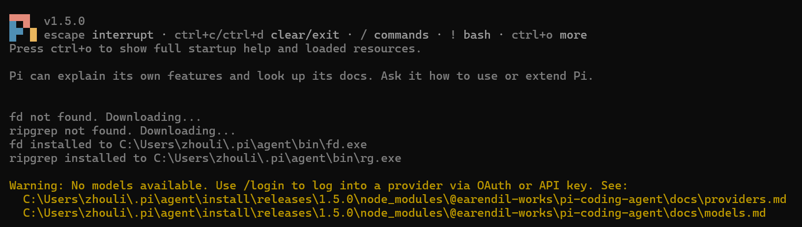
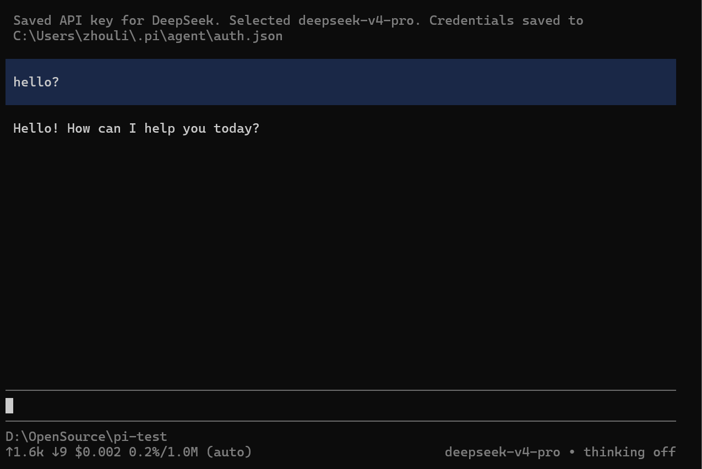
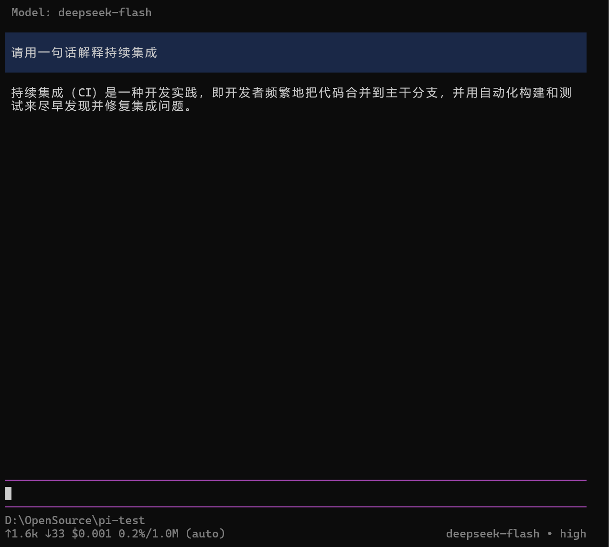
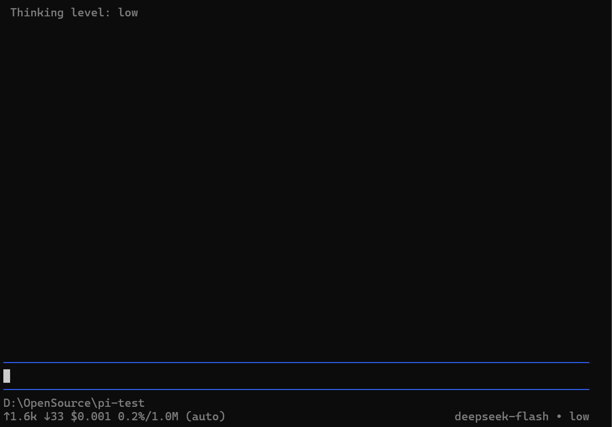
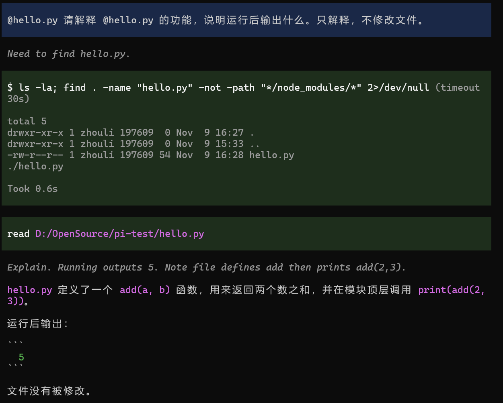
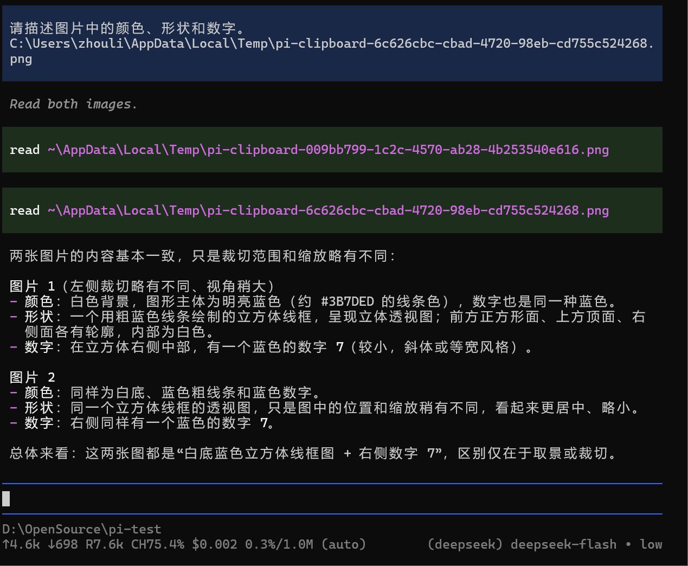
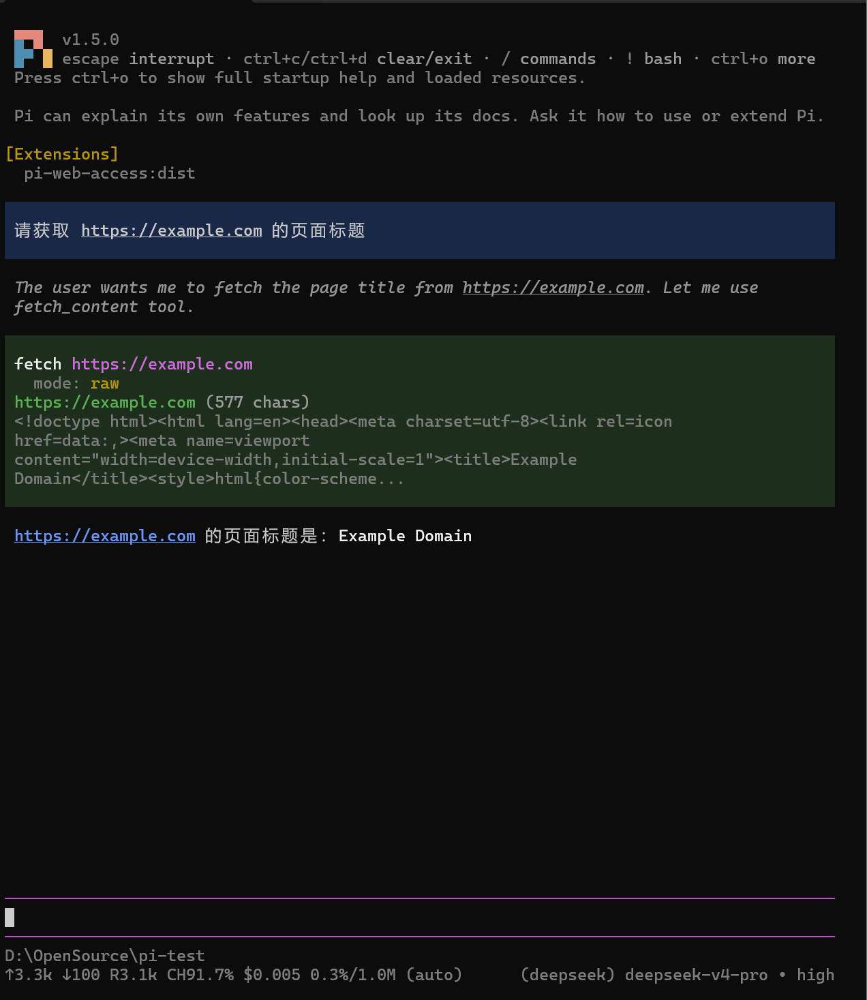
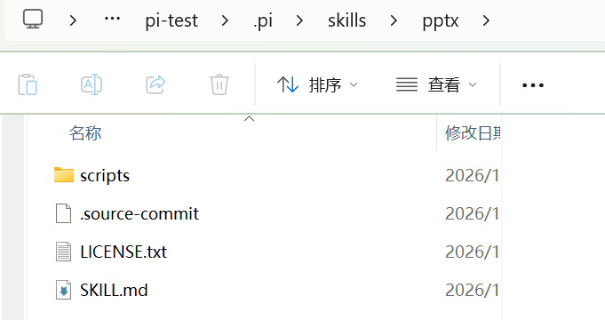
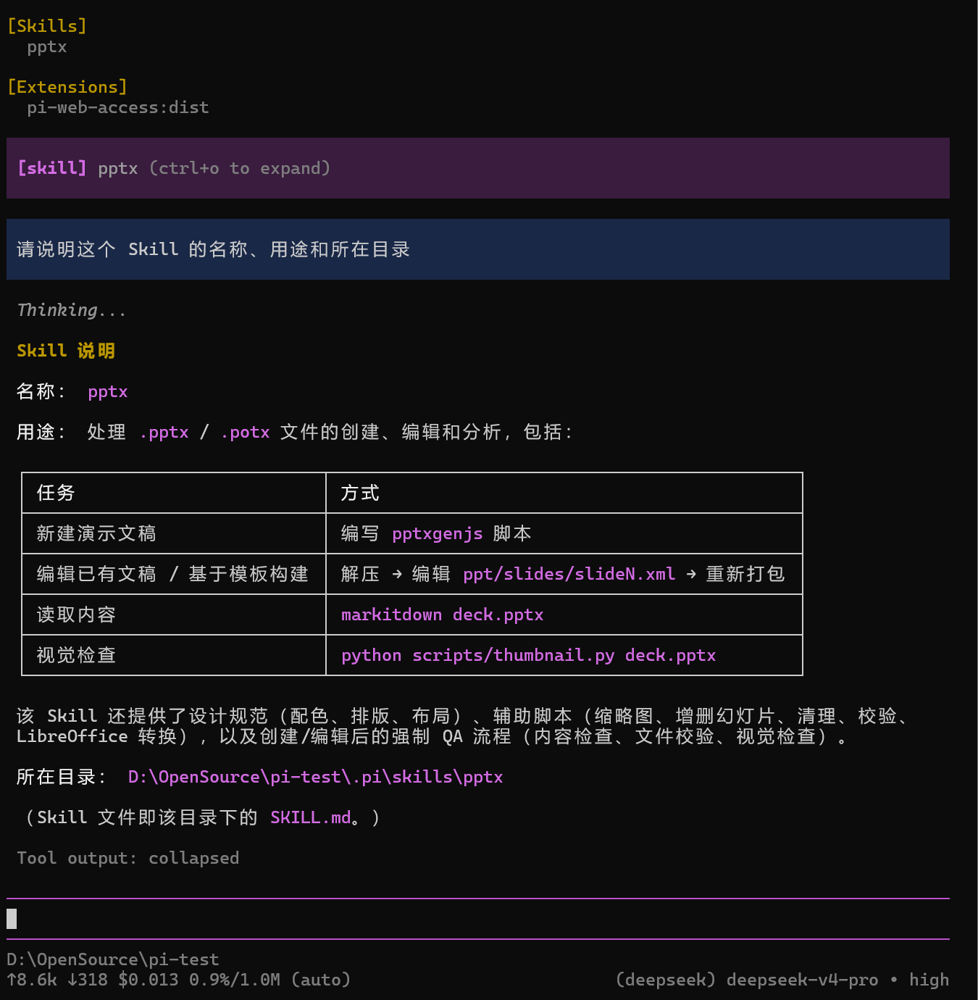

# 实践课1：Pi Agent 安装与基础使用实验报告

**姓名：** 周丽
**学号：** 202430224012
**实验日期：** 2026-11-10

## 一、 实验目的
1. 掌握 Pi Agent 客户端的本地安装与启动方法。
2. 掌握配置大模型 API 及进行基础会话的流程。
3. 熟悉模型切换、思考级别调整等高级功能。
4. 掌握使用 `@` 引用代码文件及多模态图片输入的使用。
5. 掌握 Pi 插件（Extension）与技能（Skill）的安装、加载与调用方法。

## 二、 实验环境
* **操作系统：** Windows
* **Node.js 版本：** v24.18.0
* **Git 环境：** Git Bash (`D:\develop\Git\bin\bash.exe`)
* **Pi Agent 版本：** v1.5.0

---

## 三、 实验任务与结果

### 任务一：本地安装并启动 Pi
**操作过程：**
1. 从官方仓库获取 Windows 安装命令并执行。在安装过程中，遇到了网络超时导致自动下载 `fd` 和 `ripgrep` 失败，以及 Git Bash 安装程序 504 报错的问题。
2. **问题解决：** 手动配置了本地已安装的 Git Bash 路径（`shellPath`），并开启代理以及通过Git Bash重新启动Pi，成功让 Pi 自动下载并安装了 `fd` 和 `rg` 搜索工具。
3. 在专用练习文件夹 `D:\OpenSource\pi-test` 中成功启动 Pi 客户端。

**启动截图：**
> *注：此处已成功下载 fd 和 ripgrep，并提示需要配置模型。*

---

### 任务二：配置模型并完成会话
**操作过程：**
1. 前往 DeepSeek 官方 API 平台申请了 API Key。
2. 在 Pi 的终端中输入 `/login`，选择 `Sign in with an API key`，选择 DeepSeek 提供商并粘贴密钥。
3. 提示配置成功，模型自动选中为 `deepseek-v4-pro`。
4. 输入 `hello?` 进行了最简单的测试，模型成功回复。

**配置与对话截图：**
> *注：已成功保存凭证，并收到了模型的正常回复。*

---

### 任务三：切换模型与模型思考级别
**操作过程：**
1. **切换模型：** 输入 `/model`，将模型从 `deepseek-v4-pro` 切换为 `deepseek-flash`。发送提示词“请用一句话解释持续集成”，确认新模型正常工作。
2. **切换思考级别：** 使用 `/thinking`将思考级别从 `high` 降为 `low`。
3. **状态记录与选择说明：** 
   * 切换前：`deepseek-v4-pro` 模型，底部状态栏显示 `thinking high`。
   * 切换后：`deepseek-flash` 模型，底部状态栏显示 `Thinking level: low`。
   * **选择说明：** 对于简单的代码解释（持续集成），选择 `low` 级别可以大幅降低响应延迟并节省 token 消耗；对于复杂的代码重构或系统设计任务，则应选择 `high` 级别以获取更严谨的推理逻辑。

**切换前后截图：**
> *切换为 deepseek-flash 且思考级别为 high*

> *思考级别切换为 low*

---

### 任务四：引用代码并粘贴小图片

**A. 使用 @ 引用代码文件**
在 `pi-test` 目录下创建了 `hello.py`，输入 `@hello.py` 并发送提示词要求解释。Pi 成功通过 `ls` 和 `find` 命令定位到文件，并使用 `read` 读取内容，准确解释了 `add` 函数并给出了输出结果 `5`。

**B. 粘贴小图片并测试**
1. 准备了一张 200x200 像素、包含蓝色立方体线框及数字 7 的图片，复制到剪贴板。
2. 在 Pi 输入区使用快捷键（`Alt+V`）成功粘贴图片。
3. 发送提示词：“请描述图片中的颜色、形状和数字。”模型成功识别出白底、蓝色线框立方体以及右侧的数字 7。

*(原始测试小图)*

---

### 任务五：安装并使用一个插件
**操作过程：**
1. 从 Pi Packages 官网选择了 `pi-web-access` 插件,允许Pi Agent实时联网搜索并读取网页、GitHub仓库等网络内容。
2. 执行 `pi install npm:pi-web-access -l --approve` 完成个人级安装。
3. 退出并重启 Pi，启动项中成功显示 `[Extensions] pi-web-access:dist`。
4. **功能试用：** 发送提示词“请获取 https://example.com 的页面标题”。模型自动调用 `fetch` 工具抓取网页，并准确返回了标题 `Example Domain`。

**加载与试用截图：**

---

### 任务六（选做）：让 AI 安装 PPTSkill
**操作过程：**
1. 按照指导，让 AI 从 `anthropics/skills` 仓库下载 `pptx` 目录至当前项目的 `.pi/skills/pptx`。
2. 检查了目录结构，确认包含 `scripts` 文件夹、`SKILL.md`、`LICENSE.txt` 等核心文件。

3. 退出并重新启动 Pi，在启动信息中成功发现 `[Skills] pptx`。
4. **调用验证：** 输入 `/skill:pptx 请说明这个 Skill 的名称、用途和所在目录`。AI 成功读取 Skill 说明，给出了详细的用途（新建文稿、编辑、读取、视觉检查等）及准确的本地路径。

---

## 四、 实验总结
通过本次实践，我成功搭建并运行了 Pi Agent 客户端。在安装阶段，我克服了网络超时和依赖缺失的问题，通过修改 `settings.json` 和利用代理环境解决了 `fd`/`ripgrep` 的下载故障；在功能探索中，我体会到通过 API 接入大模型的便捷性，并掌握了不同模型及思考级别切换带来的性能与成本平衡；此外，利用 `@` 引用文件和原生多模态图片识别功能极大地提升了开发体验；最后通过扩展插件和 Skill 的安装，验证了 Pi 作为高度可定制化 Agent 框架的强大生态能力。整个实验为后续深入源码分析打下了坚实的工具基础。