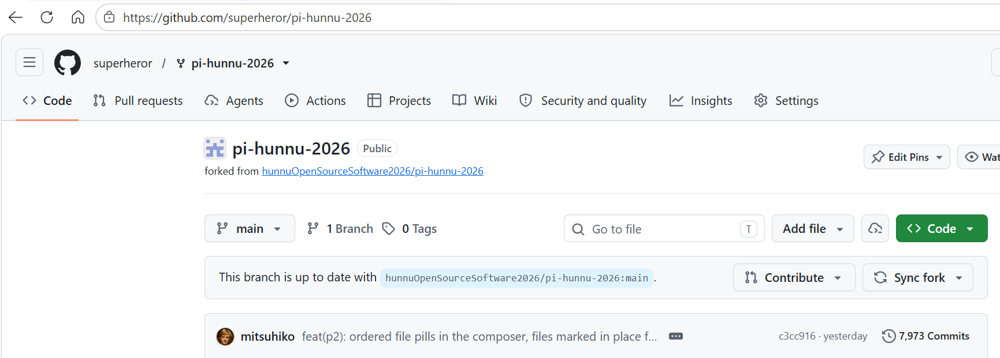
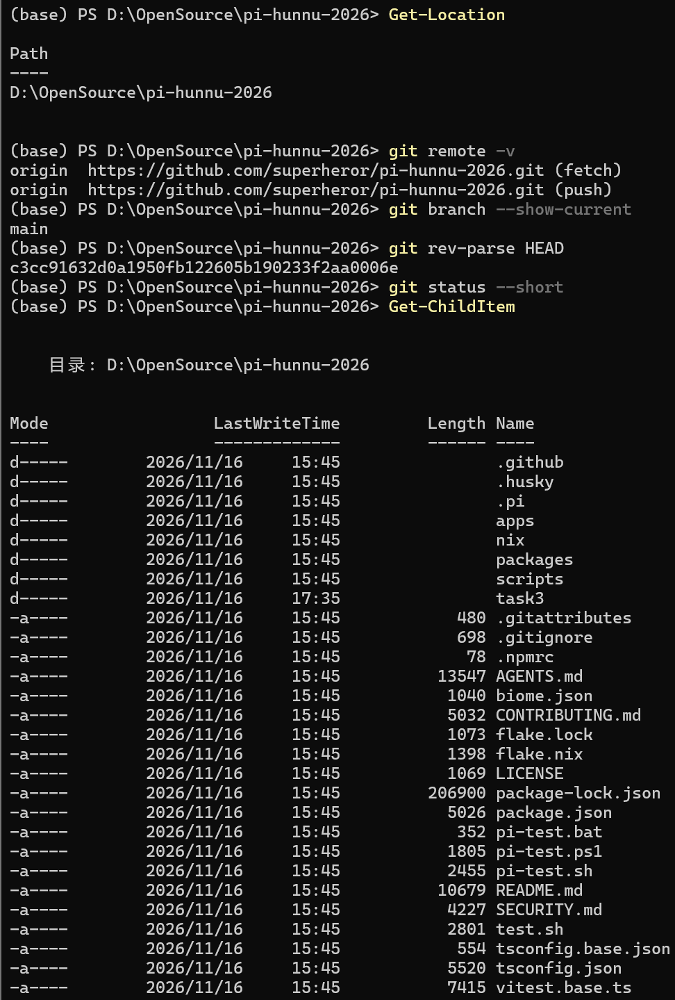
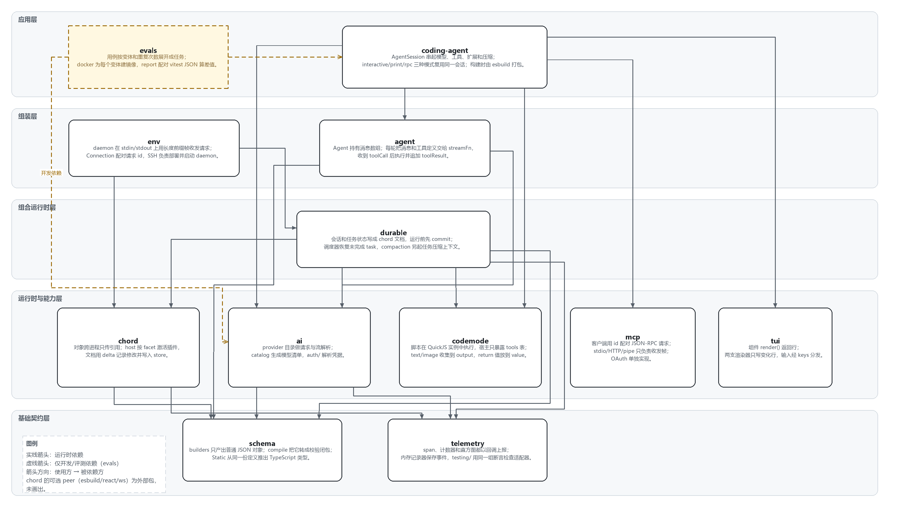

# 实践课 2 任务三：子模块功能与依赖关系分析

分析对象：`d:\OpenSource\pi-hunnu-2026`，分支 `main`，提交 `c3cc91632d0a1950fb122605b190233f2aa0006e`。

`packages/` 下共 12 个模块。作业表格列出 11 个，本仓库多出 `evals`，下文单独说明。

分析依据：

- 各模块 `package.json` 中的 `scripts.build`、`dependencies`、`devDependencies`、`peerDependencies`、`exports`、`bin`；
- 各模块 `tsconfig.build.json`，以及它们继承的根目录 `tsconfig.base.json`；
- `src/` 目录结构与跨包 import 的实际出现位置；
- 根目录 `package.json` 的 `build` 脚本；
- `scripts/build-coding-agent-bundle.mjs`、`packages/ai/catalog/generate.ts`、`packages/evals/docker/Dockerfile`、`vitest.base.ts`；
- `.github/workflows/env-daemons.yml`（`packages/env/bin/` 的生成方式，由 `build-binaries.yml` 调用）。

## 源码获取

本报告使用的源码来自小组仓库（GitHub Owner：`superheror`）：

- 克隆地址：`https://github.com/superheror/pi-hunnu-2026.git`
- 本地目录：`d:\OpenSource\pi-hunnu-2026`
- 当前分支：`main`
- 提交编号：`c3cc91632d0a1950fb122605b190233f2aa0006e`

克隆命令：

```powershell
git clone --branch main https://github.com/superheror/pi-hunnu-2026.git
cd pi-hunnu-2026
```



图 1：仓库页面。画面包含 Owner `superheror`、仓库名 `pi-hunnu-2026`、默认分支 `main`，以及仓库与课程仓库的 fork 关系。



图 2：本地克隆结果。画面包含 `Get-Location`、`git remote -v`、`git branch --show-current`、`git rev-parse HEAD`、`git status --short`、`Get-ChildItem` 的输出，可以看到 `origin` 指向小组仓库、当前分支为 `main`、完整提交编号和 `packages/` 目录。


## 1. 构建顺序

根 `npm run build` 按固定顺序执行 11 个模块，`evals` 不在链中。下表的顺序就是根 `package.json` 中 `scripts.build` 的实际顺序。

| 序号 | 模块 | 本模块执行的构建 | 主要产物 | 构建前必须已完成的内部模块 |
|---|---|---|---|---|
| 1 | `telemetry` | `tsc -p tsconfig.build.json` | `dist/`：JS、`.d.ts`、source map | 无 |
| 2 | `schema` | `tsc -p tsconfig.build.json` | 同上 | 无 |
| 3 | `chord` | `tsc -p tsconfig.build.json` | 同上 | `schema`、`telemetry` |
| 4 | `tui` | `tsc -p tsconfig.build.json` | 同上；原生模块另由 `build:native:*` 构建 | 无 |
| 5 | `codemode` | `tsc -p tsconfig.build.json` | 同上 | 无 |
| 6 | `mcp` | `tsc -p tsconfig.build.json` | 同上 | 无 |
| 7 | `ai` | `generate-models` → `build:offline`（校验数据、`tsc`、复制数据） | `dist/` 和 `dist/providers/` 下的模型数据 | `schema`、`telemetry` |
| 8 | `durable` | `tsc -p tsconfig.build.json` | `dist/` | `chord`、`ai`、`codemode`、`schema`、`telemetry` |
| 9 | `env` | `tsc -p tsconfig.build.json` | `dist/`；daemon 由 `build:daemon` 单独构建 | `durable`、`chord` |
| 10 | `agent` | `tsc -p tsconfig.build.json` | `dist/` | `ai`、`schema` |
| 11 | `coding-agent` | `build:unbundled` → esbuild 打包 | `dist/` 和 `dist/bundle/` | `agent`、`ai`、`codemode`、`mcp`、`tui` |
| — | `evals` | 无 `build` 脚本 | 无 `dist/` | 不在根构建链中 |

两点补充：

- `build:offline` 的顺序与上表相同，只把第 7 步换成 `ai` 的 `build:offline`，跳过联网刷新模型数据。
- 表中的依赖列说明顺序是按依赖关系排的，但并不是每个相邻步骤都互相依赖；具体分析见 4.2 节。

## 2. 模块分析表

| 子文件夹 | 代码主要实现什么功能 | 本模块 build 执行什么、生成什么 | 直接依赖哪些内部模块 | 依据文件或代码位置 |
|---|---|---|---|---|
| `telemetry` | 给各包提供同一套 `TelemetryContext`/`TelemetrySpan` 回调接口和指标类型；`src/memory.ts` 是内存实现，`noop.ts` 用于关闭遥测，`testing/` 提供适配器一致性用例。上下文由调用方显式传入，包内不保存全局 span。 | `tsc -p tsconfig.build.json`。读取 `packages/telemetry/tsconfig.build.json`（继承根 `tsconfig.base.json`），把 `src/` 编译到 `dist/`，生成 JS、`.d.ts`、source map。无额外生成步骤。 | 无 | `packages/telemetry/package.json` 的 `scripts.build`、`exports`；`src/index.ts`、`src/metrics.ts`、`src/memory.ts`、`src/noop.ts`、`src/testing/`；`tsconfig.build.json` |
| `schema` | 用 `builders.ts` 构造普通 JSON Schema，`compiler.ts` 把它编译成校验闭包，`validator`/`checks` 执行检查并返回 JSON Pointer 错误；`types.ts` 提供 `Static` 类型推导。支持 draft 2020-12 和 7，运行时不生成代码。 | `tsc -p tsconfig.build.json`，输出 `dist/` 下的 JS 与声明文件。无额外生成步骤。`ajv`、`zod` 等只出现在 devDependencies，用于测试对照。 | 无 | `packages/schema/package.json`；`src/compiler.ts`、`src/validator.ts`、`src/builders.ts`、`src/formats/`；`tsconfig.build.json` |
| `chord` | `contracts`/`host`/`facet` 描述跨进程对象，`documents` 与 `store` 负责事务和持久化，`link` 负责引用与调用转发，`node/plugins` 做插件构建和热重载；`node/http`、`node/workers`、`web`、`react`、`tui` 是各宿主与客户端的接入层。 | `tsc -p tsconfig.build.json`，输出 `dist/`。无额外生成步骤。 | `@earendil-works/pi-schema`、`@earendil-works/pi-telemetry` | `packages/chord/package.json` 的 `dependencies`、`peerDependenciesMeta`；`src/index.ts` 及 `src/{contracts,documents,store,link,node,web,tui}/`；`tsconfig.build.json` |
| `tui` | 定义 `Component.render` 和 `TUI` 接口，`tui-main-screen`/`tui-alt-screen` 是两套渲染实现；编辑器、Markdown、列表等组件在 `components/` 下，`keys.ts` 与 `keybindings.ts` 处理输入，渲染器逐行比较后只重绘变化部分。 | `tsc -p tsconfig.build.json`，输出 `dist/`。原生剪贴板模块由单独的 `build:native:darwin`、`build:native:linux`、`build:native:win32` 脚本编译，不在 `npm run build` 中执行。 | 无 | `packages/tui/package.json` 的 `scripts`、`files`；`src/tui.ts`、`src/tui-main-screen.ts`、`src/tui-alt-screen.ts`、`src/components/`、`native/`；`tsconfig.build.json` |
| `codemode` | `CodemodeSandbox` 把脚本送进 QuickJS/WASM，只注入调用方给的 tools；Node 下每次执行开 worker，Cloudflare 下走 `RemoteCodemodeSandbox`。脚本的 `text`/`image`/返回值写回 `output`/`value`，嵌套工具调用不进入模型消息。 | `tsc -p tsconfig.build.json`，输出 `dist/`，包含 runtime 与 worker 入口。无额外生成步骤。 | 无 | `packages/codemode/package.json` 的 `scripts.build`、`dependencies`（`quickjs-wasi`）；`src/index.ts`、`src/runtime/`、`src/wasm.ts`、`src/portable.ts`；`tsconfig.build.json` |
| `mcp` | `McpClient` 负责 JSON-RPC 请求关联、初始化、超时和取消，`transports/` 下实现 stdio、Streamable HTTP、pipe 和内存测试传输；`oauth/` 处理授权流程，`input-schema`/`naming`/`output-limit` 处理参数、工具名和结果大小。 | `tsc -p tsconfig.build.json`，输出 `dist/`。无额外生成步骤。 | 无 | `packages/mcp/package.json`；`src/client.ts`、`src/protocol/`、`src/transports/`、`src/oauth/`；`tsconfig.build.json` |
| `ai` | `providers/` 按厂商实现请求与响应转换，`api/` 放各协议实现，`models.ts`/`models-store.ts` 维护模型目录，`auth/` 解析凭据和 OAuth；对外用统一的 `stream`/`complete` 事件，图片与分类走各自 catalog。 | `npm run build` 先执行 `generate-models`：`node catalog/generate.ts --strict` 联网读取各提供商和聚合站的模型清单，写入 `src/models.generated.ts`、`src/providers/<provider>.models.ts` 与 `src/providers/data/*.json`。随后执行 `build:offline`：`check:model-data` 校验模型数据，`tsc -p tsconfig.build.json` 编译到 `dist/`，清掉旧的 `dist/providers/data` 后把 `src/providers/data` 复制到 `dist/providers`。`build:offline` 跳过联网生成步骤。 | `@earendil-works/pi-schema`、`@earendil-works/pi-telemetry` | `packages/ai/package.json` 的 `scripts.build`、`scripts.build:offline`；`catalog/generate.ts`；`scripts/check-model-data.ts`；`src/providers/`、`src/utils/validation.ts`；`tsconfig.build.json` |
| `durable` | `harness/` 把对话拆成 `AgentDoc`、`GenerationTask`、`ToolTask` 等可持久化任务，文档经 chord store 提交；`storage/` 提供 memory、JSONL、SQLite 等适配，`session/` 负责恢复与调度，`harness/compaction` 处理上下文压缩。 | `tsc -p tsconfig.build.json`，输出 `dist/`。该配置用 `paths` 指向 `../chord/dist` 和 `../ai/dist` 的声明文件。无额外生成步骤。 | `@earendil-works/chord`、`@earendil-works/pi-ai`、`@earendil-works/pi-codemode`、`@earendil-works/pi-schema`、`@earendil-works/pi-telemetry` | `packages/durable/package.json` 的 `dependencies`；`src/harness/`、`src/storage/`、`src/env/`、`src/codemode/`、`src/tools/`；`tsconfig.build.json` |
| `env` | `Connection` 在本地进程或 SSH 上跑 daemon 的帧协议，`ssh.ts` 负责主机密钥校验、平台检测、部署和启动；`RemoteExecutionEnv` 与 `LocalExecutionEnv` 实现 `durable/env` 的文件、命令、终端和 watch 接口。 | `tsc -p tsconfig.build.json`，输出 `dist/`。Rust daemon 由独立的 `build:daemon`（`cargo build`）构建；发布包使用的 `bin/` 预编译产物由发布工作流按目标平台构建（该目录被 gitignore），两者都不属于 `npm run build`。 | `@earendil-works/chord`、`@earendil-works/pi-durable` | `packages/env/package.json` 的 `scripts`、`dependencies`、`files`；`daemon/`、发布工作流生成的 `bin/`、`src/remote-env.ts`、`src/ssh.ts`、`src/connection.ts`；`tsconfig.build.json` |
| `agent` | `Agent` 持有消息和工具状态，`agent-loop` 驱动“请求模型—执行工具—回填结果”的循环；`proxy.ts` 提供经服务器转发的 stream 函数，`stream-fn.ts` 允许宿主设置默认 stream 函数；工具实现由调用方注入，事件通过 `subscribe` 发出。 | `tsc -p tsconfig.build.json`，输出 `dist/`。配置中的 `paths` 指向 `../ai/dist` 的声明文件。 | `@earendil-works/pi-ai`、`@earendil-works/pi-schema` | `packages/agent/package.json` 的 `dependencies`；`src/agent.ts`、`src/agent-loop.ts`、`src/types.ts`；`tsconfig.build.json` |
| `coding-agent` | `cli/args` 与 `main.ts` 解析入口，`core/agent-session.ts` 组合模型、工具、扩展和压缩，`modes/` 提供 interactive、print、rpc 前端；`extensions/` 下有 codemode 和 MCP 适配，`core/package-manager.ts`、`core/skills.ts` 负责包与技能加载。 | `npm run build` 先执行 `build:unbundled`：`tsc -p tsconfig.build.json` 编译到 `dist/`，给 `cli.js`、`rpc-entry.js` 加可执行位，并复制主题、图片、HTML 导出模板。随后执行 `node ../../scripts/build-coding-agent-bundle.mjs`，用 esbuild 打包出 `dist/bundle/`：`cli`、`index`、`rpc-entry` 主入口，OAuth 与 Bedrock 懒加载入口，codemode worker 和 image-resize worker。`bin.pi` 指向 `dist/bundle/cli.js`。 | `@earendil-works/pi-agent-core`、`@earendil-works/pi-ai`、`@earendil-works/pi-codemode`、`@earendil-works/pi-mcp`、`@earendil-works/pi-tui` | `packages/coding-agent/package.json` 的 `scripts.build`、`scripts.build:unbundled`、`dependencies`、`bin`；`scripts/build-coding-agent-bundle.mjs`；`tsconfig.build.json`；`src/modes/`、`src/core/`、`src/extensions/` |
| `evals` | `src/` 是评测执行器：`plan` 把每个用例按变体和重复次数展开，`docker` 构建并运行有/无文档两个镜像，`report` 读取 vitest JSON 并计算文档带来的提升；`evals/` 放用例，`test/` 测执行器。 | 没有 `build` 脚本，不生成 `dist/`。宿主机上的普通测试和 `eval:host` 评测从 TypeScript 源码运行：vitest 配置把 `@earendil-works/pi-coding-agent` 指到源码。`eval:docs` 用 `node --experimental-strip-types src/cli.ts` 启动，但其 Docker 镜像先用 `npm run build:offline` 构建并安装打包后的 workspace 包，比较对象是构建产物。不在根 `build` 链中。 | `@earendil-works/pi-ai`、`@earendil-works/pi-coding-agent`（仅 `devDependencies`） | `packages/evals/package.json` 的 `private`、`scripts`、`devDependencies`；`vitest.evals.config.ts`、`vitest.test.config.ts`；`src/{cli,docker,harness,plan,report}.ts`、`docker/Dockerfile`；根 `package.json` 的 `scripts.build` |

补充：

- `chord` 的 `esbuild`、`react`、`ws` 是可选 peer 依赖，只被 `/plugins`、`/react`、`/http`、`/tui/launcher`、`/surfaces`、`/workers` 等子路径使用，且都是外部包，不是内部模块，因此不在依赖图中。
- `tui`、`codemode`、`mcp` 没有任何内部模块依赖，可以单独安装和使用。
- `evals` 是唯一使用内部包但只放在 `devDependencies` 的模块，且 `private: true`。

## 3. 模块层级与依赖关系图

图源：[module-dependencies.drawio](module-dependencies.drawio)。用 VS Code 的 draw.io 扩展打开后可编辑、导出 PNG/SVG。



图：箭头方向为“使用方 → 被依赖方”；实线为运行时依赖，虚线为 `evals` 的开发依赖。模块框内的文字是对该模块功能的概括。

### 3.1 箭头与区分

- 箭头方向统一为“使用方 → 被依赖方”。
- 实线箭头：运行时依赖，写在 `dependencies` 中，源码实际 import。
- 虚线箭头：仅开发/评测依赖，写在 `devDependencies` 中（只有 `evals` 属于这一类）。
- 图中没有内部可选依赖；`chord` 的可选 peer 都是外部包，见上文补充。

### 3.2 层级划分依据

分层同时看两件事：包在系统中的职责，以及它到最底层契约包的内部依赖深度。除 `evals` 对 `coding-agent` 的评测依赖外，同层模块之间没有运行时依赖。

| 层 | 模块 | 划分依据 |
|---|---|---|
| 基础契约层 | `schema`、`telemetry` | 没有内部依赖，只提供被其他包复用的校验与遥测契约，放在最底层。 |
| 运行时与能力层 | `chord`、`ai`、`tui`、`codemode`、`mcp` | `chord`、`ai` 只依赖基础契约层；`tui`、`codemode`、`mcp` 没有任何内部依赖。它们职责都是可被上层直接复用的能力（状态运行时、模型访问、终端 UI、沙箱、协议客户端），而不是通用契约，所以与 `chord`、`ai` 放在同一层。 |
| 组合运行时层 | `durable` | 同时组合 `chord` 的文档状态、`ai` 的模型访问、`codemode` 的沙箱，并把 `schema`、`telemetry` 用在自身接口上，属于对下层能力的组合。 |
| 组装层 | `agent`、`env` | `agent` 把 `ai` 包装成通用循环；`env` 把 `durable` 接到 SSH 远端执行。二者都是较薄的装配层，不再引入新的基础能力。 |
| 应用层 | `coding-agent`、`evals` | `coding-agent` 是面向用户的最终产品；`evals` 是只针对该产品的私有评测工具，用虚线表示开发依赖。 |

### 3.3 图中的直接依赖

实线：

- `coding-agent → agent`
- `coding-agent → ai`
- `coding-agent → codemode`
- `coding-agent → mcp`
- `coding-agent → tui`
- `agent → ai`
- `agent → schema`
- `env → durable`
- `env → chord`
- `durable → chord`
- `durable → ai`
- `durable → codemode`
- `durable → schema`
- `durable → telemetry`
- `chord → schema`
- `chord → telemetry`
- `ai → schema`
- `ai → telemetry`

虚线（仅开发）：

- `evals → ai`
- `evals → coding-agent`

## 4. 问题回答

### 4.1 根目录与子模块的 `npm run build` 分别读取什么配置、执行什么工作？

根目录的 `build` 不读取 TypeScript 配置。它读取根 `package.json` 的 `scripts.build`，执行一条写死的链：

```text
telemetry → schema → chord → tui → codemode → mcp → ai → durable → env → agent → coding-agent
```

每个环节都是 `cd packages/<模块> && npm run build`，所以根构建只负责顺序，实际编译由各模块自己的 `build` 脚本完成。`build:offline` 的顺序完全相同，只把 `ai` 的 `build` 换成 `build:offline`，跳过联网刷新模型数据。

子模块的 `build` 分三类：

1. 常规 TypeScript 编译：`telemetry`、`schema`、`chord`、`tui`、`codemode`、`mcp`、`durable`、`env`、`agent` 都执行 `tsc -p tsconfig.build.json`。该配置继承根 `tsconfig.base.json`（`target` ES2024、`module`/`moduleResolution` Node16、`strict`、`declaration`、source map、`erasableSyntaxOnly` 等），设置 `rootDir: src`、`outDir: dist`，把源码编译成 `dist/` 下的 JS、`.d.ts` 和 map 文件。
2. `ai`：先联网生成模型数据，再编译。`generate-models` 运行 `catalog/generate.ts --strict`，读取 `catalog/` 下的提供商定义并从网络获取模型清单，生成 `src/models.generated.ts`、`src/providers/<provider>.models.ts` 和 `src/providers/data/*.json`；`build:offline` 先校验这些数据，再 `tsc`，清掉旧的 `dist/providers/data` 后把数据目录复制到 `dist/providers`。
3. `coding-agent`：先 `build:unbundled`（`tsc` 输出 `dist/`，加可执行位，复制主题、图片、HTML 导出模板），再运行 `scripts/build-coding-agent-bundle.mjs`，用 esbuild 把 `dist/` 代码和依赖打包成 `dist/bundle/`，包括 `cli`、`index`、`rpc-entry` 主入口、OAuth/Bedrock 懒加载入口、codemode worker 和 image-resize worker。最终 `bin.pi` 指向 `dist/bundle/cli.js`。

另外，有两个模块还带有不在 `npm run build` 中的独立构建步骤：

- `tui` 的原生剪贴板模块由 `build:native:*` 单独编译；根构建里的 `tui` 只执行 `tsc`。
- `env` 的 Rust daemon 由 `build:daemon`（`cargo build`）单独构建，发布包直接携带发布工作流生成的 `bin/` 预编译产物。

`evals` 没有 `build` 脚本，宿主侧的测试和评测由 vitest 直接从 TypeScript 源码转换执行，`eval:docs` 则用 `node --experimental-strip-types` 启动，不产生 `dist/`；`eval:docs` 在 Docker 中评测的是构建后的 workspace 包。

### 4.2 构建顺序和模块依赖有什么关系？相邻构建的模块是否一定互相依赖？

构建顺序基本是内部依赖图的一个拓扑排序：被依赖的模块先构建，使用方后构建。可以逐项核对：

- `telemetry`、`schema` 没有内部依赖，排在最前；
- `chord`、`ai` 依赖 `schema` 和 `telemetry`，排在两者之后；
- `durable` 依赖 `chord`、`ai`、`codemode`、`schema`、`telemetry`，排在这些模块之后；
- `env` 依赖 `durable`、`chord`，排在两者之后；
- `agent` 依赖 `ai`、`schema`，排在两者之后；
- `coding-agent` 依赖 `agent`、`ai`、`codemode`、`mcp`、`tui`，排在最后。

顺序必须满足依赖，是因为构建读取的是已生成的声明文件，而不是源码：

- 没有显式 `paths` 的包，TypeScript 通过 `node_modules/@earendil-works/*` 的工作区软链接读取依赖包 `package.json` 的 `types` 字段，该字段指向 `dist/index.d.ts`；
- `durable`、`env`、`agent`、`coding-agent` 的 `tsconfig.build.json` 进一步用 `paths` 指向已生成的声明文件：`durable` 指 `../chord/dist` 和 `../ai/dist`；`env` 指 `../chord/dist/context` 和 `../durable/dist/env`；`agent` 指 `../ai/dist`；`coding-agent` 指 `../agent/dist`、`../ai/dist` 和 `../tui/dist`。
- `coding-agent` 的打包脚本还会检查 `packages/ai/dist` 和 `packages/coding-agent/dist` 下的入口文件是否存在，缺失时直接报错并提示先构建工作区包。

相邻构建的模块不一定互相依赖。反例：

- 第 3 个 `chord` 与第 4 个 `tui` 没有依赖关系，`chord` 不使用 `tui`；
- 第 6 个 `mcp` 与第 7 个 `ai` 没有依赖关系，`mcp` 只被最后的 `coding-agent` 使用；
- 第 9 个 `env` 与第 10 个 `agent` 没有依赖关系；
- `tui`、`codemode`、`mcp` 三个包没有任何内部依赖，它们的位置只是为了在各自的消费者之前完成构建。

因此这条链是“满足依赖的一个线性化”，不是一条依赖链。独立模块只要能排在它的使用方之前，放到别的位置也不会破坏构建。

### 4.3 选择一条至少涉及三个模块的依赖路径，说明这些模块如何分工

选择路径：`coding-agent → pi-agent-core → pi-ai → pi-schema`（四个模块）。

- `coding-agent` 负责产品层：解析命令行参数、管理会话、注册 read/bash/edit/write 等工具、处理扩展与 skills，并把模型事件渲染到交互界面或通过 RPC 输出。它从 `pi-agent-core` 引入 `Agent`、`AgentMessage`、`StreamFn` 等类型和循环实现。
- `pi-agent-core` 负责 agent 循环：维护消息状态，把用户输入交给模型，接收流式事件，识别并执行工具调用，再把工具结果送回下一轮。它不知道具体是哪家模型提供商。
- `pi-ai` 负责模型访问：把统一的消息和工具定义转换成各提供商的请求，处理认证、流式响应、用量统计和图片输入。它提供 `validateToolArguments`，内部用 `pi-schema` 的 `compile` 把工具参数的 JSON Schema 编译成校验器；`pi-agent-core` 在执行工具前调用它来校验并窄化参数类型。
- `pi-schema` 负责最底层的校验：把 JSON Schema 编译成普通闭包，提供 `compile`、类型推导和错误路径，不依赖上层任何模块。

一次具体调用可以串起这条路径：用户在 `coding-agent` 提交消息 → `AgentSession` 调用 `pi-agent-core` 的 agent 循环 → 循环通过 `pi-ai` 的流函数请求模型 → 模型返回工具调用，`pi-agent-core` 调用 `pi-ai` 的 `validateToolArguments`，后者用 `pi-schema` 编译出的校验器检查参数 → `pi-agent-core` 执行工具并把结果送回模型 → `coding-agent` 把过程和结果渲染到界面。

这条路径也说明依赖是传递的：`coding-agent` 的 `package.json` 没有直接声明 `pi-schema`，它是通过 `pi-agent-core` 和 `pi-ai` 间接用到底层校验能力的。

## 5. 与作业表格的差异

本仓库比作业表格多一个模块 `packages/evals`：

- 它只用于对 `coding-agent` 做行为评测和文档效果对比，不发布；
- `package.json` 中 `private: true`，内部包只放在 `devDependencies`；
- 没有 `build` 脚本，不产生 `dist/`，也不在根 `npm run build` 链中；
- 宿主机上运行时，用 vitest 的源码别名和 Node 的类型剥离直接执行 TypeScript；`eval:docs` 的 Docker 镜像内则使用 `npm run build:offline` 的构建产物。

其余 11 个模块与作业表格一致。
