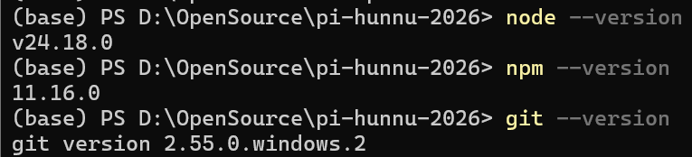
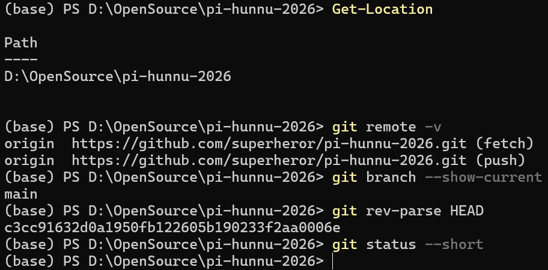
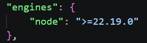
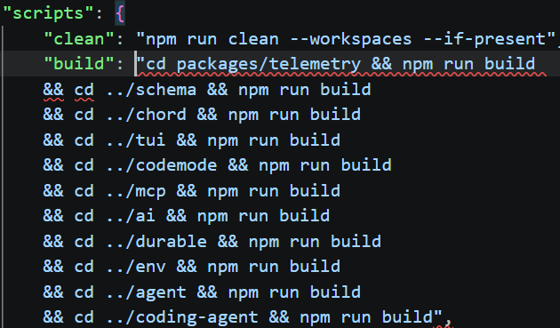
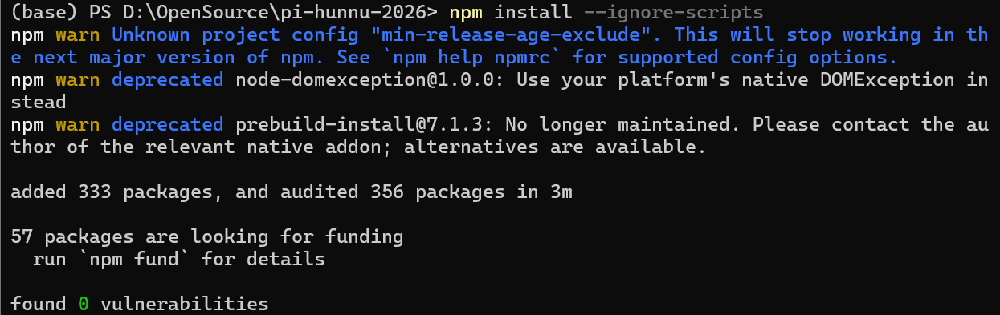
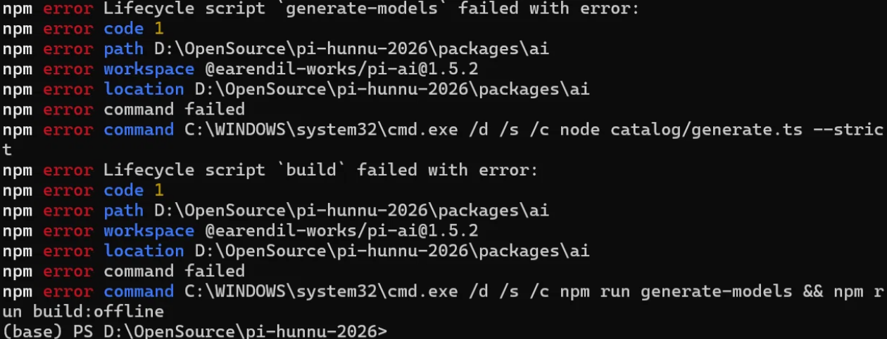
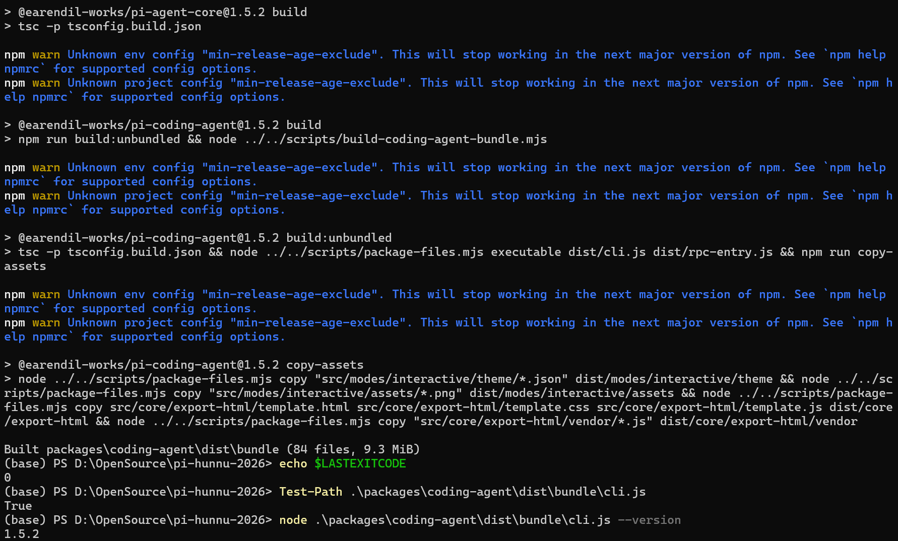
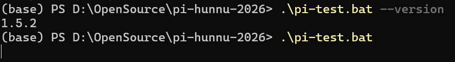
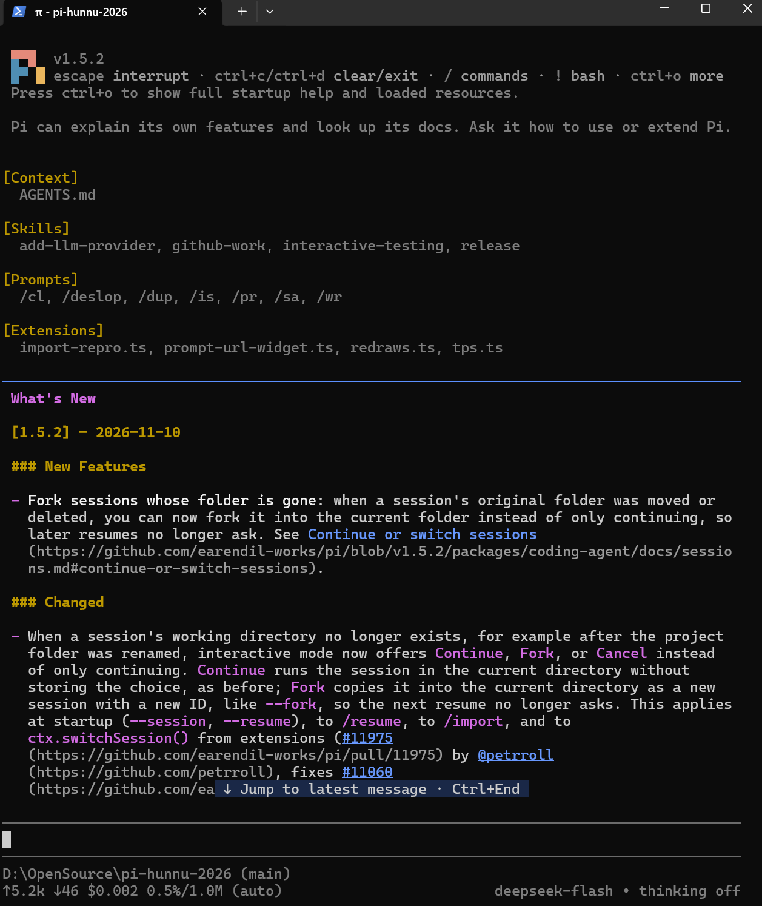
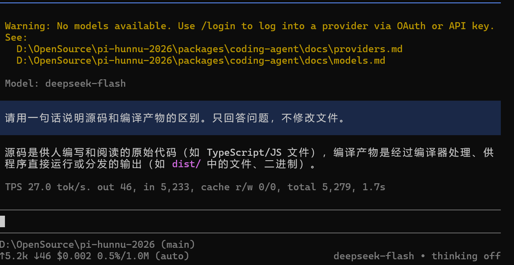

# 实践课3：Pi Agent 源码获取、依赖安装与本地编译实验报告

**姓名：** 周丽
**学号：** 202430224012
**实验日期：** 2026-11-17

## 一、实验环境

| 项目 | 实际值 |
|---|---|
| 操作系统 | Windows 11（10.0.26200） |
| Node.js | v24.18.0 |
| npm | 11.16.0 |
| Git | 2.55.0.windows.2 |
| 源码目录 | `D:\OpenSource\pi-hunnu-2026` |
| 远端仓库 | `https://github.com/superheror/pi-hunnu-2026.git`（小组组织内 fork） |
| 分支 | `main` |
| 提交编号 | `c3cc91632d0a1950fb122605b190233f2aa0006e` |

本次使用 Node.js 24 LTS 系列，高于根 `package.json` 声明的 `>=22.19.0`，因此安装阶段没有出现 `EBADENGINE` 警告。

---

## 二、实验任务与结果

### 任务一：检查开发工具

在 PowerShell 中依次执行：

```powershell
node --version
npm --version
git --version
```

结果如图 1：Node.js 为 **v24.18.0**，npm 为 **11.16.0**，Git 为 **2.55.0.windows.2**。三条命令都正常返回版本号，说明当前终端能够找到这三个工具。npm 随 Node.js 一起安装，未另外单独安装。



*图1 `node --version`、`npm --version`、`git --version` 的实际输出。*

### 任务二：获取源码并确认版本

源码使用第二次实践时已经克隆的小组仓库，本次直接确认其来源和版本：

```powershell
Get-Location
git remote -v
git branch --show-current
git rev-parse HEAD
git status --short
```

结果如图 2：

- 当前目录：`D:\OpenSource\pi-hunnu-2026`；
- `origin` 的 fetch 和 push 地址均为 `https://github.com/superheror/pi-hunnu-2026.git`，与小组组织内仓库一致；
- 当前分支：`main`；
- 完整提交编号：`c3cc91632d0a1950fb122605b190233f2aa0006e`；
- `git status --short` 没有输出，工作区干净。



*图2 本地目录、远端地址、分支、提交编号和工作区状态。*

### 任务三：阅读配置，确认安装与编译依据

查看根目录的 `README.md`、`package.json`、`package-lock.json`、`packages/` 以及 `packages/coding-agent/package.json` 后，得到以下信息：

| 文件或目录 | 观察结果 |
|---|---|
| `README.md` 的 `Development` | 列出安装、构建、离线构建、检查、测试和源码启动的开发命令 |
| 根 `package.json` 的 `engines` | `"node": ">=22.19.0"` |
| 根 `package.json` 的 `workspaces` | 使用 npm workspaces 管理 `packages/*`、`apps/*` 及若干示例目录 |
| 根 `package.json` 的 `devDependencies` | TypeScript、esbuild、Biome、husky 等只在开发、构建和测试阶段使用的工具 |
| 根 `package.json` 的 `scripts` | 定义构建、检查、测试、模型数据、发布等 npm 命令；其中 `scripts.build` 依次 `cd` 进入 11 个包并执行各自 `npm run build`，用 `&&` 串联 |
| `package-lock.json` | 锁定依赖版本和依赖关系，安装时以它为准 |
| `packages/` | 12 个 workspace 子包，每个包都有自己的 `package.json`、`src/` 和构建配置 |
| `packages/coding-agent/package.json` | `bin.pi` 指向 `dist/bundle/cli.js`，`build` 先 `build:unbundled` 再用 esbuild 打包 |

#### 1. README 的 Development 命令

| 命令 | 作用 |
|---|---|
| `npm install --ignore-scripts` | 按根 `package.json` 和 `package-lock.json` 安装所有 workspace 的依赖，跳过 `postinstall`、`prepare` 等安装期生命周期脚本；只准备依赖，不编译 |
| `npm run build` | 先刷新模型目录数据（`ai` 的 `generate-models` 需要联网），再按顺序构建全部包，生成各包的 `dist/` 和 `coding-agent` 的 `dist/bundle/` |
| `npm run build:offline` | 复用已有模型数据，跳过联网刷新，其余构建流程与 `npm run build` 相同；用于首次构建成功后的重复构建 |
| `npm run check` | 运行 Biome 检查并写入格式化结果，检查依赖版本、运行时依赖、TypeScript import、入口图等，再执行 `tsc --noEmit` 类型检查；不生成构建产物 |
| `./test.sh` | 在隔离的临时用户目录中运行测试；没有配置 API Key 时跳过依赖大模型调用的测试 |
| `./pi-test.sh` | 不经过构建，直接用源码启动 Pi，可在任意目录运行；Windows 下对应 `pi-test.bat` / `pi-test.ps1` |

这些命令的分工是：`install` 准备依赖，`build` 生成产物，`build:offline` 在已有模型数据时省去联网，`check` 做静态检查与格式化，`test.sh` 跑测试，`pi-test.sh` 直接从源码运行客户端。

#### 2. 根 package.json 的 scripts

根 `package.json` 的 `scripts` 不只有 `build`，它把仓库的开发流程都封装成了 npm 命令。主要分组如下：

| 类别 | 代表脚本 | 作用 |
|---|---|---|
| 清理与准备 | `clean`、`prepare` | `clean` 递归执行各 workspace 的 `clean`（没有该脚本的包跳过）；`prepare` 初始化 husky 的 Git hooks |
| 构建 | `build`、`build:offline`、`build:native:*` | `build` 按链构建全部包；`build:offline` 复用已有模型数据；`build:native:*` 按平台编译 `tui` 的原生剪贴板模块 |
| 检查 | `check`、`check:pinned-deps`、`check:runtime-deps`、`check:ts-imports`、`check:entry-graphs`、`check:model-data` 等 | `check` 聚合 Biome、依赖版本、运行时依赖、相对 import、入口图、安装锁、`tsc --noEmit` 类型检查和浏览器冒烟检查；单项检查也可以单独运行 |
| 测试与评测 | `test`、`test:scripts`、`eval` | `test` 先运行脚本测试，再运行各 workspace 的测试；`eval` 运行 `evals` 包的评测 |
| 模型数据 | `generate:models`、`hydrate:model-data`、`check:model-data`、`generate:model-catalog` | 分别用于联网生成模型数据、只补齐数据文件、校验已有数据和生成发布用的模型目录 JSON |
| 发布与版本 | `prepublishOnly`、`publish`、`pack:packages`、`version:*`、`release:*` | 发布前执行清理、构建和检查；打包本地包或修改版本号 |
| 性能分析 | `profile:tui`、`profile:rpc` | 对 TUI 和 RPC 模式运行性能采样 |

本次实验实际用到的是 `npm install` 和 `npm run build`；`build:offline` 是首次构建成功后可选的离线重建命令，本次没有使用。其余脚本说明该仓库还包含检查、测试、评测和发布等完整开发流程。`scripts.build` 的具体链路见本节后面的图 4 和构建顺序。

#### 3. 根 package.json 的 devDependencies

根 `devDependencies` 中声明的主要工具：

| 包 | 用途 |
|---|---|
| `typescript@7.0.2` | 各包执行 `tsc -p tsconfig.build.json` 编译和类型检查 |
| `esbuild@0.28.2` | `coding-agent` 打包 `dist/bundle/` |
| `@biomejs/biome@2.3.5`、`@biomejs/wasm-nodejs@2.3.5` | lint 与代码格式化，`npm run check` 会调用 |
| `@types/node@22.19.19` | Node.js API 的类型声明 |
| `husky@9.1.7` | 安装 Git hooks，对应根 `prepare` 脚本 |
| `pnpm@11.15.1` | 固定 pnpm 版本，供需要 pnpm 的脚本或环境使用 |
| `yaml@2.9.0` | 脚本读取 YAML 配置 |

`devDependencies` 只在开发、构建和测试时需要，不会成为发布包的运行时依赖；`npm install` 会把它们一并装到根 `node_modules`。因此本地构建需要它们，而用户安装发布后的包时不会重复安装这些工具。各子包的测试、编译依赖则写在各子包自己的 `devDependencies` 中。

#### 4. packages/ 目录

`packages/` 是仓库的主体，共 12 个 workspace 子包。每个子包都有自己的 `package.json`、`src/` 和构建配置，编译后生成各自的 `dist/`；`evals` 是例外，它是私有评测包，没有 `build` 脚本，也不生成 `dist/`。根目录 `npm install` 统一安装依赖并建立链接（例如 `node_modules/@earendil-works/pi-agent-core` 指向 `packages/agent`），根 `npm run build` 按依赖顺序逐个构建除 `evals` 外的 11 个包。

按职责可以分成四组：

- 基础契约：`telemetry`（遥测接口）、`schema`（JSON Schema 校验）；
- 运行时能力：`chord`（文档与状态）、`tui`（终端界面）、`codemode`（沙箱）、`mcp`（MCP 客户端）、`ai`（模型访问）；
- 组合与装配：`durable`（持久化任务）、`env`（本地/SSH 执行环境）、`agent`（Agent 循环）；
- 应用与评测：`coding-agent`（CLI 产品，`bin.pi` 所在包）、`evals`（私有评测工具，没有 `build` 脚本，不在根构建链中）。

根 `engines` 与 `scripts.build` 的定义如图 3、图 4。



*图3 `engines.node` 声明为 `>=22.19.0`。*



*图4 `scripts.build` 的完整构建链。*

图4 中的红色波浪线不是仓库配置本身的错误。根 `scripts.build` 实际是一整条单行 JSON 字符串；为了在截图里完整展示构建链，我临时在字符串中插入了换行。JSON 不允许普通字符串跨行，VS Code 因此提示“意外的字符串结尾”（unexpected end of string），并在每段末尾画上红线。仓库中的原文件仍然是单行字符串，`npm run build` 能正常执行；这里的红线只是截图排版造成的。

根构建链的实际顺序为：

```text
telemetry → schema → chord → tui → codemode → mcp → ai → durable → env → agent → coding-agent
```

**回答报告问题：**

1. **Node.js 版本要求在哪里？** 在仓库根目录 `package.json` 的 `engines.node` 字段中，值为 `>=22.19.0`。这是项目自身声明的最低版本；某个依赖包还可能声明更高的版本要求，因此安装日志中的 `EBADENGINE` 仍需要单独核对。本次使用 v24.18.0，满足该要求。
2. **`npm run build` 实际从哪里读取命令？** 它读取根 `package.json` 的 `scripts.build`。根脚本本身不执行编译，只负责按顺序 `cd` 到每个 workspace 包并执行该包自己的 `npm run build`；具体编译什么由各包的 `scripts.build` 和 `tsconfig.build.json` 决定（例如常规包执行 `tsc -p tsconfig.build.json`，`ai` 先联网生成模型数据，`coding-agent` 最后用 esbuild 打包）。`&&` 表示前一步成功后才继续，因此任一包失败，后面的包都不会执行。

### 任务四：安装项目依赖

在仓库根目录执行：

```powershell
npm install --ignore-scripts
```



*图5 依赖安装结束时的输出：added 333 packages、audited 356 packages、found 0 vulnerabilities。*

本次安装结果：

- 新增 **333** 个包，审计 **356** 个包，耗时约 3 分钟；
- `found 0 vulnerabilities`，本次审计没有报告已知漏洞；
- 有 57 个包提示可以资助（funding），这只是提示信息；
- 输出结束于 `found 0 vulnerabilities`，未出现 `npm error`。

安装过程出现的告警及含义：

| 输出 | 类型 | 含义与处理 |
|---|---|---|
| `Unknown project config "min-release-age-exclude"` | 配置告警 | 当前 npm 版本不认识该配置项，属于兼容性提示，不影响本次安装，未修改 |
| `deprecated node-domexception@1.0.0` | 弃用告警 | 依赖包已弃用，安装仍可继续 |
| `deprecated prebuild-install@7.1.3` | 弃用告警 | 上游包不再维护的提示，不等同于安装失败 |
| `57 packages are looking for funding` | 提示 | 仅提示资助渠道，与功能无关 |
| `found 0 vulnerabilities` | 审计结果 | 本次审计未发现已知漏洞，不代表构建一定成功 |

### 任务五：本地编译与构建产物验证

#### 5.1 首次构建失败

首次执行：

```powershell
npm run build
```

构建进行到 `packages/ai` 时失败，输出如图 6：

```text
npm error Lifecycle script `generate-models` failed with error:
npm error code 1
npm error path D:\OpenSource\pi-hunnu-2026\packages\ai
npm error workspace @earendil-works/pi-ai@1.5.2
npm error command failed
npm error command C:\WINDOWS\system32\cmd.exe /d /s /c node catalog/generate.ts --strict
...
npm error Lifecycle script `build` failed with error:
npm error code 1
npm error workspace @earendil-works/pi-ai@1.5.2
npm error command npm run generate-models && npm run build:offline
```



*图6 首次构建在 `packages/ai` 的 `generate-models` 步骤失败，退出码为 1。*

由于根 `scripts.build` 使用 `&&` 串联，`ai` 失败后，`durable`、`env`、`agent`、`coding-agent` 都没有执行，因此此时还没有生成 `packages/coding-agent/dist/bundle/cli.js`。失败原因和定位过程见第三节。

#### 5.2 关闭代理后重新构建

关闭代理后，重新在仓库根目录执行同一条命令：

```powershell
npm run build
```

本次构建完成，输出末尾如图 7：

```text
> @earendil-works/pi-coding-agent@1.5.2 build
> npm run build:unbundled && node ../../scripts/build-coding-agent-bundle.mjs
...
Built packages\coding-agent\dist\bundle (84 files, 9.3 MiB)
```

随后验证退出码和构建产物：

```powershell
echo $LASTEXITCODE
Test-Path .\packages\coding-agent\dist\bundle\cli.js
node .\packages\coding-agent\dist\bundle\cli.js --version
```

结果：

- `$LASTEXITCODE` 为 **0**；
- `Test-Path` 输出 **True**，入口文件存在；
- 通过本地路径运行得到版本号 **1.5.2**，与 `packages/coding-agent/package.json` 的版本一致；
- 打包产物共 84 个文件、约 9.3 MiB。



*图7 构建结束输出、`$LASTEXITCODE` 为 0、入口文件存在，以及 `--version` 输出版本 1.5.2。*

构建过程说明：

- 除 `ai` 和 `coding-agent` 外的 9 个包分别执行自己的 `tsc -p tsconfig.build.json`，把 `src/` 编译到各自的 `dist/`；
- `ai` 包先执行 `generate-models`（`node catalog/generate.ts --strict`）联网生成模型目录数据，再执行 `build:offline` 校验数据、编译并把模型数据复制到 `dist/providers`；
- `coding-agent` 先 `build:unbundled` 编译到 `dist/`，再用 `scripts/build-coding-agent-bundle.mjs` 调用 esbuild 打包出 `dist/bundle/`；
- `dist/` 是构建产物。以后修改功能应改 `src/` 再重新构建，直接改 `dist/` 可能被下次构建覆盖。

### 任务六：启动本地源码版本并完成会话

#### 6.1 验证源码入口

在仓库根目录执行：

```powershell
.\pi-test.bat --version
.\pi-test.bat
```

第一条命令输出版本 **1.5.2**，第二条启动本地源码版 Pi 的交互界面，如图 8。



*图8 使用仓库根目录的 `pi-test.bat` 验证版本并启动。*

`pi-test.bat` 的实际调用链是：

```text
pi-test.bat → pi-test.ps1 → node --import packages/coding-agent/src/experimental/source-resolver.ts packages/coding-agent/src/cli.ts
```

也就是说，它让 Node.js 直接加载 `packages/coding-agent/src/cli.ts` 源码，不经过 `dist/`。

#### 6.2 启动界面与会话

启动后的界面如图 9：窗口标题为 `π - pi-hunnu-2026`，版本为 **v1.5.2**；`[Context]` 加载了仓库的 `AGENTS.md`，`[Skills]`、`[Prompts]`、`[Extensions]` 也显示了仓库内的资源（如 `import-repro.ts`、`prompt-url-widget.ts`、`redraws.ts`、`tps.ts`），底部状态栏显示工作目录 `D:\OpenSource\pi-hunnu-2026 (main)` 和模型 `deepseek-flash`。



*图9 本地源码版 Pi 的启动界面，显示版本、仓库上下文、技能、扩展和当前模型。*

本地源码版与第一次实践安装的全局版本共用用户配置目录 `~/.pi/agent`。本次启动后终端提示 `No models available. Use /login ...`，说明当时还没有可用模型；因此我按提示执行了 `/login`，选择使用 **API Key** 登录，配置了一个模型（本次使用 `deepseek-flash`）。登录后的凭据保存在共用的 `~/.pi/agent` 中，界面底部随之显示当前模型为 `deepseek-flash`。

发送的提示词为：

```text
请用一句话说明源码和编译产物的区别。只回答问题，不修改文件。
```

模型实际回复：

> 源码是供人编写和阅读的原始代码（如 TypeScript/JS 文件），编译产物是经过编译器处理、供程序直接运行或分发的输出（如 dist/ 中的文件、二进制）。



*图10 通过 `/login` 登录模型后，在本地源码版 Pi 中发送提示词并收到实际回复；上方是登录前的无模型提示。*

说明：图中的 `No models available. Use /login ...` 是**登录前**的提示，不是构建或启动失败。执行 `/login` 并用 API Key 完成模型登录后，界面显示 `Model: deepseek-flash`，本次请求也成功收到了回复。因此报告把“本地程序启动成功”和“模型配置/调用”分开记录：前者由界面、版本号和仓库上下文证明，后者由登录后的实际模型回复证明；如果模型调用失败，不能直接归因于编译失败。

**回答报告问题：**

1. **本次如何确保运行的是本地源码？** 没有直接输入 `pi`（那可能启动第一次实践安装的全局版本），而是使用仓库根目录的 `.\pi-test.bat`。它通过 `pi-test.ps1` 让 Node.js 直接加载 `packages/coding-agent/src/cli.ts`；界面中的仓库路径、`AGENTS.md`、仓库内 Skills/Extensions 以及版本号也都指向当前源码。编译产物则另外用 `node .\packages\coding-agent\dist\bundle\cli.js --version` 单独验证。
2. **源码入口与 `dist/bundle/cli.js` 入口分别适合什么场景？**
   - 源码入口（`.\pi-test.bat`）适合日常开发和调试：修改 `src/` 后无需先构建即可运行，报错栈指向 TypeScript 源码，便于定位问题。
   - `dist/bundle/cli.js` 入口适合验证构建结果和接近发布形态的运行：它是 esbuild 打包后的产物，也是 `bin.pi` 实际指向的入口，启动时不依赖源码解析器，适合确认“构建是否成功、打包后的程序是否能正常工作”。

---

## 三、遇到的困难与解决过程

### 3.1 问题现象

首次执行 `npm run build` 时，构建停在 `packages/ai`，终端只留下 npm 的生命周期错误摘要：

- 失败的脚本是 `packages/ai` 的 `generate-models`，退出码 `code 1`；
- 失败命令是 `node catalog/generate.ts --strict`；
- 紧接着 `packages/ai` 的 `build`（`npm run generate-models && npm run build:offline`）也以 `code 1` 失败；
- 由于根构建链使用 `&&`，后续的 `durable`、`env`、`agent`、`coding-agent` 都没有执行。

### 3.2 定位过程

1. 日志显示失败的包是 `packages/ai`，失败命令是 `node catalog/generate.ts --strict`；外层的 `build` 失败只是由它连带产生的。
2. README 中 `build:offline` 的说明是“不联网、复用已有模型数据重新构建”，这提示 `npm run build` 中与它不同的部分需要联网，而失败正好发生在 `generate-models`。
3. 想到执行构建时终端开着代理，于是怀疑是代理影响了这一步的网络请求；关闭代理后重新执行 `npm run build`，构建通过，说明问题不在源码、依赖或 Node 版本。

### 3.3 原因分析

`generate-models` 需要由 Node.js 的 `fetch` 访问多个模型目录服务。代理开启时，Node 进程访问这些服务的 HTTPS 请求未能正常完成；常见原因是代理拦截或替换了 HTTPS 证书导致校验失败，或者连接被重置，这些都会表现为请求失败。由于脚本带 `--strict`，任一源失败就会抛错，`generate-models` 以 `code 1` 退出；根构建链的 `&&` 又把这个失败向上传递，导致整个 `npm run build` 中断。

这一判断的依据是“控制变量”：

- 同一份源码、同一个提交、同一个 Node.js 版本、同一条命令；
- 只改变代理开关状态，失败与成功可以稳定对应；
- 失败位置正好落在构建链中唯一联网的步骤。

### 3.4 解决步骤

1. 关闭代理软件；
2. 回到仓库根目录，重新执行 `npm run build`；
3. 构建完成后，用 `echo $LASTEXITCODE` 确认退出码为 `0`，用 `Test-Path` 确认 `packages/coding-agent/dist/bundle/cli.js` 存在；
4. 用 `node .\packages\coding-agent\dist\bundle\cli.js --version` 确认产物版本为 `1.5.2`。

### 3.5 经验总结

- 构建失败时先找**第一个失败点**，不要被后面一连串 `failed` 误导；
- 看到 `Lifecycle script ... failed` 时，应同时看 `path`、`workspace` 和 `command` 三个字段，它们能直接指出是哪个包、哪条命令；
- 只有联网步骤失败时，应优先检查网络、代理、证书和上游服务状态，而不是急着重装依赖或降低 Node.js 版本；
- 安装阶段的警告和错误要分开看：`deprecated`、`Unknown config` 等告警不会让命令失败，`npm error` 与退出码才是判断依据。

---

## 四、实验结论

| 问题 | 结论 |
|---|---|
| 源码在哪里？ | `D:\OpenSource\pi-hunnu-2026`，远端为小组仓库 `superheror/pi-hunnu-2026`，分支 `main`，提交 `c3cc91632d0a1950fb122605b190233f2aa0006e` |
| 依赖装在哪里？ | 通过根目录 `npm install --ignore-scripts` 安装在仓库根 `node_modules`；工作区内部包以链接方式指向 `packages/*`，没有安装成全局 `pi` |
| 构建执行了什么？ | 根 `scripts.build` 按 `telemetry → … → coding-agent` 顺序调用各包的 `build`；各包用 `tsc` 编译到 `dist/`，`ai` 先联网生成模型数据，`coding-agent` 最后用 esbuild 打包出 `dist/bundle/` |
| 正在运行哪个版本？ | 本地源码入口 `.\pi-test.bat --version` 输出 `1.5.2`；构建产物 `node .\packages\coding-agent\dist\bundle\cli.js --version` 同样输出 `1.5.2` |

## 五、实验总结

本次实验完成了从环境检查、源码确认、配置阅读、依赖安装到本地编译和源码运行的完整流程。构建阶段遇到了 `packages/ai` 的 `generate-models` 失败：查看根构建链和 README 中 `build:offline` 的说明后，判断失败发生在需要联网的模型目录生成步骤；结合当时终端开着代理，关闭代理后重新构建，退出码为 0，入口文件存在，版本号为 1.5.2。随后使用 `.\pi-test.bat` 启动源码版 Pi，通过 `/login` 使用 API Key 登录模型，使用 `deepseek-flash` 完成了一次真实会话。

通过这次实验，我能够清楚回答“源码在哪里、依赖装在哪里、构建执行了什么、正在运行哪个版本”，也掌握了排查构建失败的基本方法：先定位第一个失败的包和命令，再区分网络问题、配置问题和代码问题，最后用退出码、产物路径和版本号三者共同验证构建结果，而不是只看某一张成功截图或某一条日志。
