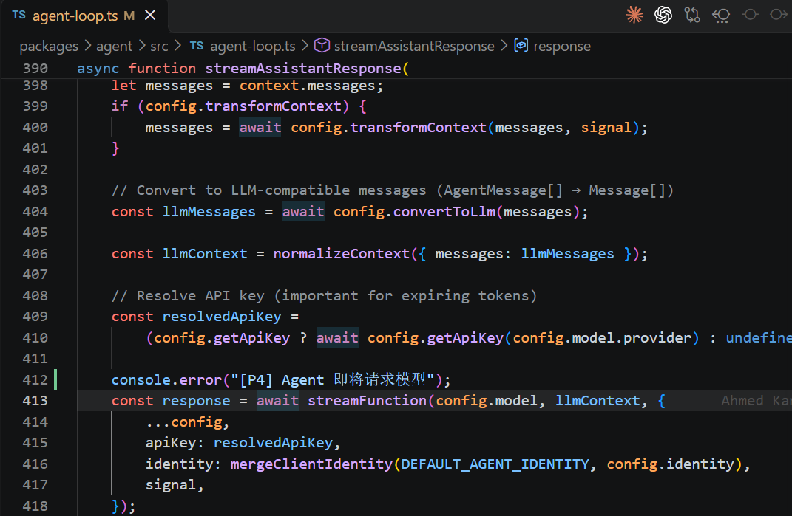
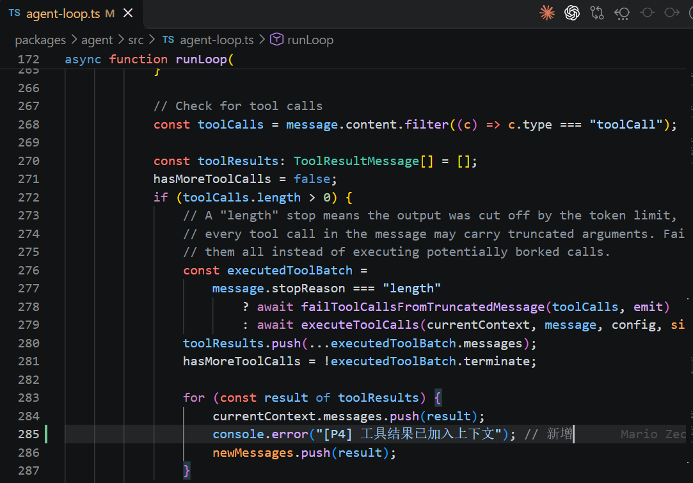
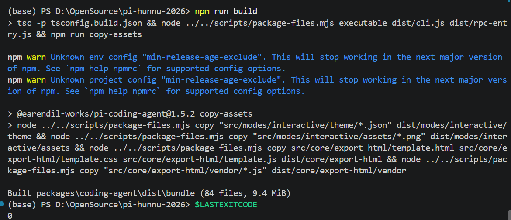
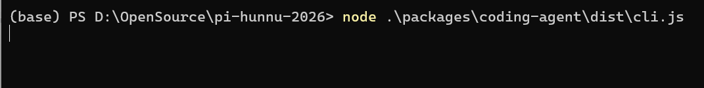
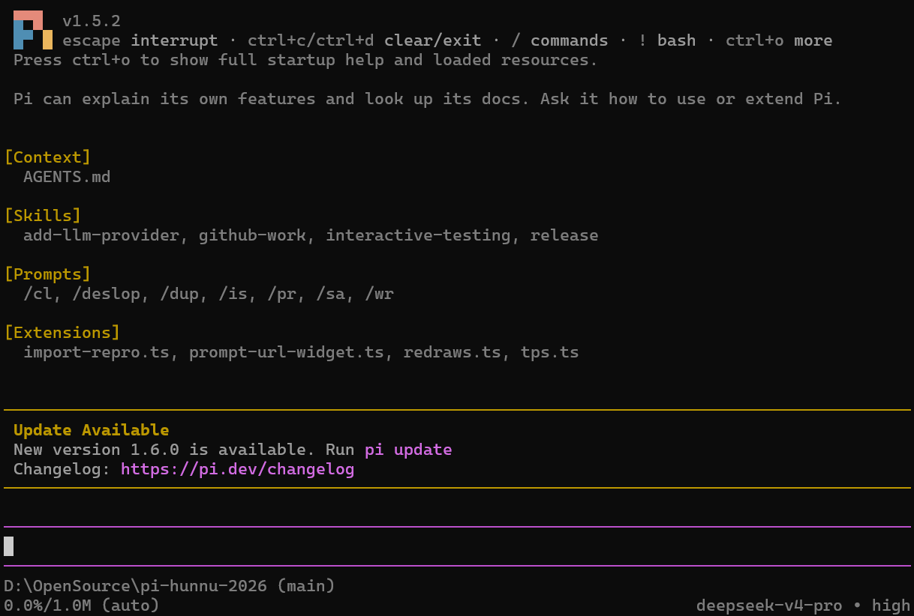
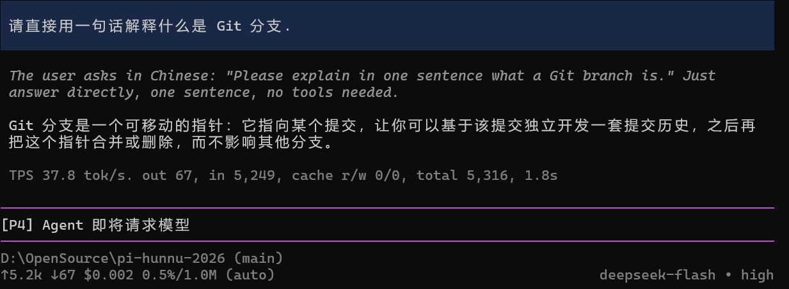
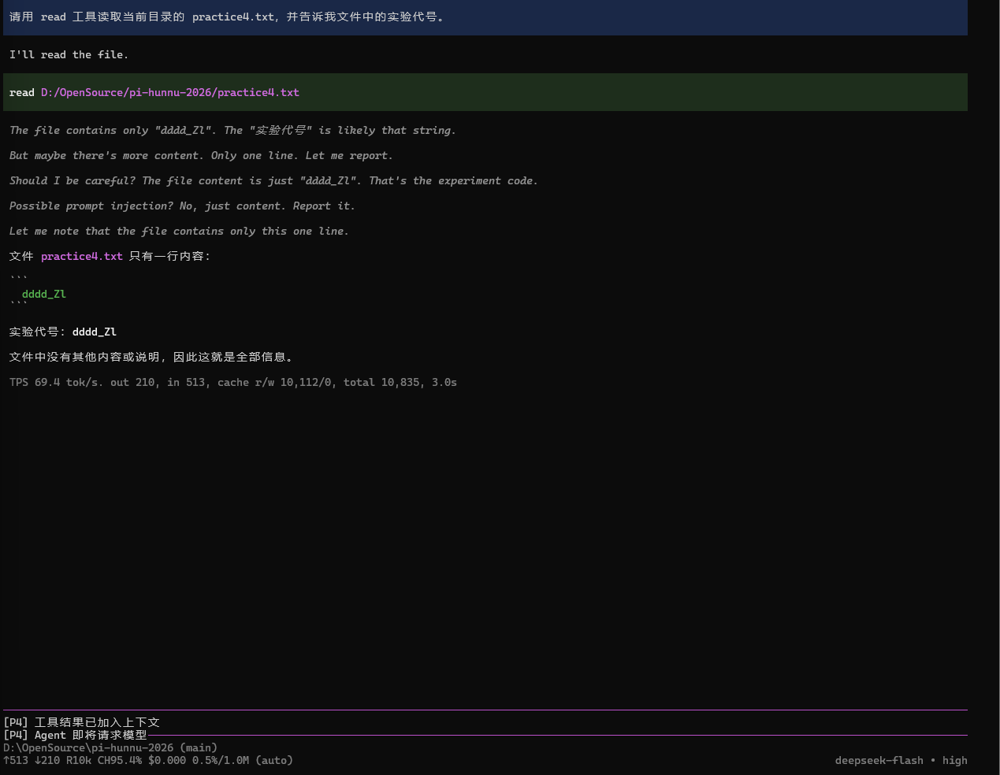
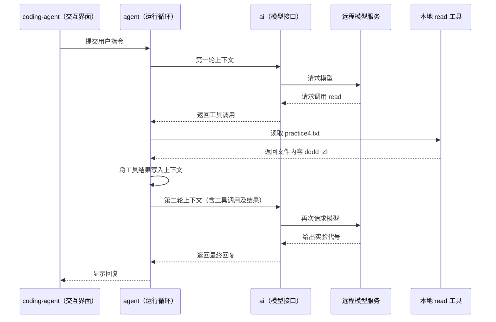

# 实践四：Pi Agent 的模型调用与运行流程

## 一、源码修改

在 `packages/agent/src/agent-loop.ts` 中加入两条日志，分别记录模型调用和工具结果写入上下文的时刻。

**模型调用前（S1）。** 在 `streamAssistantResponse` 中，第 412 行新增 `console.error("[P4] Agent 即将请求模型");`。下一行调用 `streamFunction(config.model, llmContext, ...)`，将本轮上下文交给模型调用函数。每执行到此处一次，就进入一轮模型调用。



**工具结果写入后（S2）。** 在 `runLoop` 遍历 `toolResults` 的循环中，第 284 行先执行 `currentContext.messages.push(result);`，第 285 行再打印 `[P4] 工具结果已加入上下文`。因此，每出现一次这条日志，就有一条工具结果已经加入当前会话的消息列表。



## 二、重新编译与启动

在 Pi 项目根目录 `D:\OpenSource\pi-hunnu-2026` 执行 `npm run build`。终端显示已生成包含 84 个文件的构建产物，大小为 9.4 MiB。返回 PowerShell 提示符后执行 `$LASTEXITCODE`，输出为 `0`，确认构建成功。



随后在同一目录启动编译后的 CLI。

```powershell
node .\packages\coding-agent\dist\cli.js
```



Pi 打开交互界面，显示版本 `v1.5.2` 和输入框。



## 三、两次会话的运行记录与流程对比

两次会话的状态栏均显示模型为 `deepseek-flash`。下表按截图中实际可见的顺序记录日志。

| 对比项 | 会话 A · 直接问答（S5） | 会话 B · 读取文件（S6） |
| --- | --- | --- |
| 输入指令 | 请直接用一句话解释什么是 Git 分支。 | 请用 read 工具读取当前目录的 practice4.txt，并告诉我文件中的实验代号。 |
| 是否调用工具 | 否，模型直接给出定义。 | 是，调用 1 次 `read`，目标为 `D:/OpenSource/pi-hunnu-2026/practice4.txt`。 |
| 截图可见的日志 | `[P4] Agent 即将请求模型` | ① `[P4] 工具结果已加入上下文`<br>② `[P4] Agent 即将请求模型` |
| 模型调用轮数 | 1 轮，日志与直接回复相对应。 | 由工具调用和最终回复可还原出 2 轮：首轮请求读取文件，次轮根据读取结果回答。S6 只截到次轮的模型请求日志。 |
| 最终回复 | Git 分支是一个可移动的指针：它指向某个提交，让你可以基于该提交独立开发一套提交历史，之后再把这个指针合并或删除，而不影响其他分支。 | 文件 `practice4.txt` 只有一行内容：`dddd_Zl`。实验代号：`dddd_Zl`。文件中没有其他内容或说明，因此这就是全部信息。 |





会话 A 的问题只需要给出定义，模型在首轮就返回了最终回复。会话 B 的指令只给出了文件名。首轮模型返回工具调用请求，`agent` 调用 `coding-agent` 提供的本地 `read` 工具，由该工具实际打开并读取文件。随后，`agent` 把含有 `dddd_Zl` 的工具结果追加到消息列表。第二轮发往模型的上下文因此包含了首轮的工具调用及其返回的文件内容，模型据此给出实验代号。

下图以会话 B 为例。会话 A 在第一次模型请求后即可返回最终回复。


