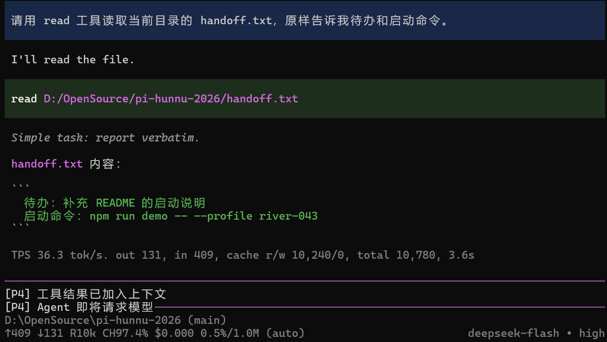
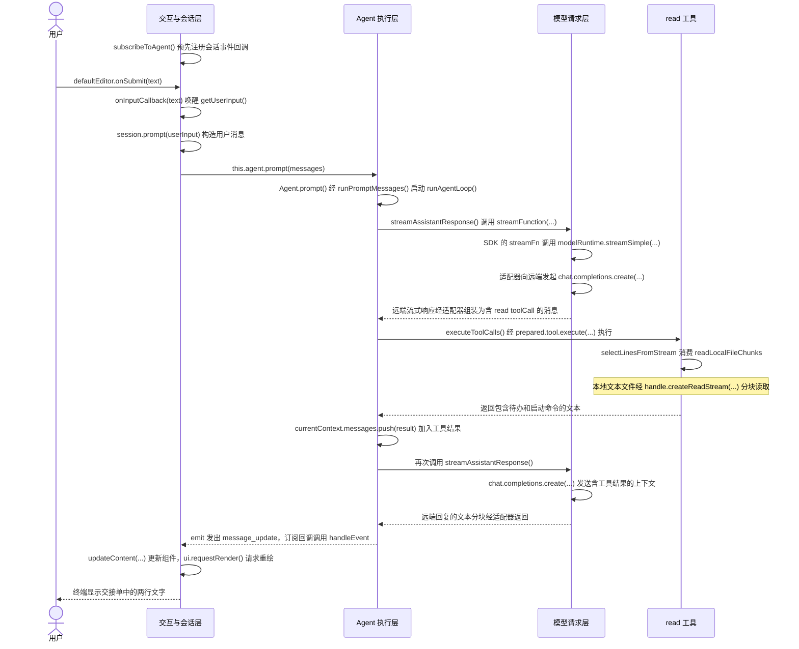
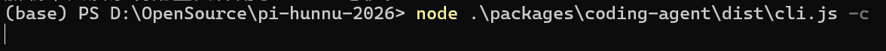
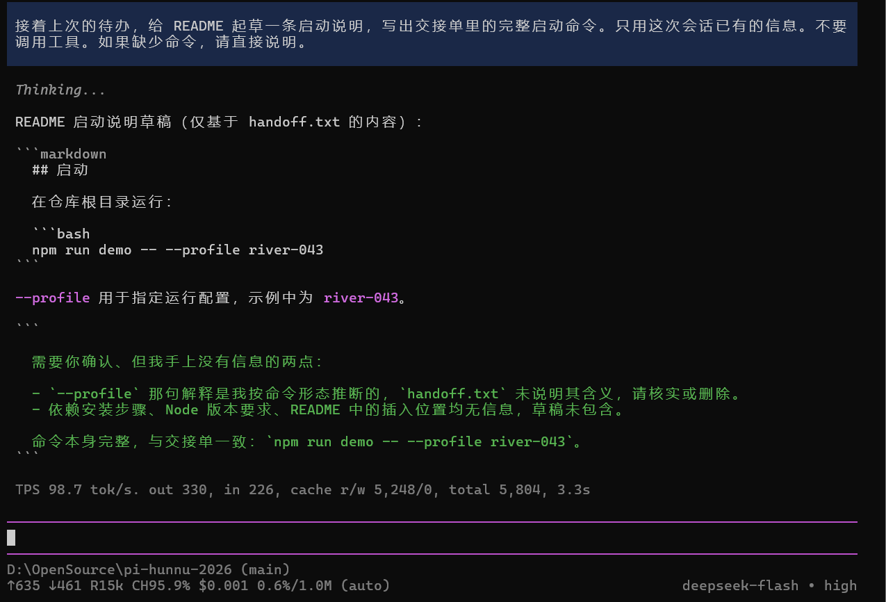
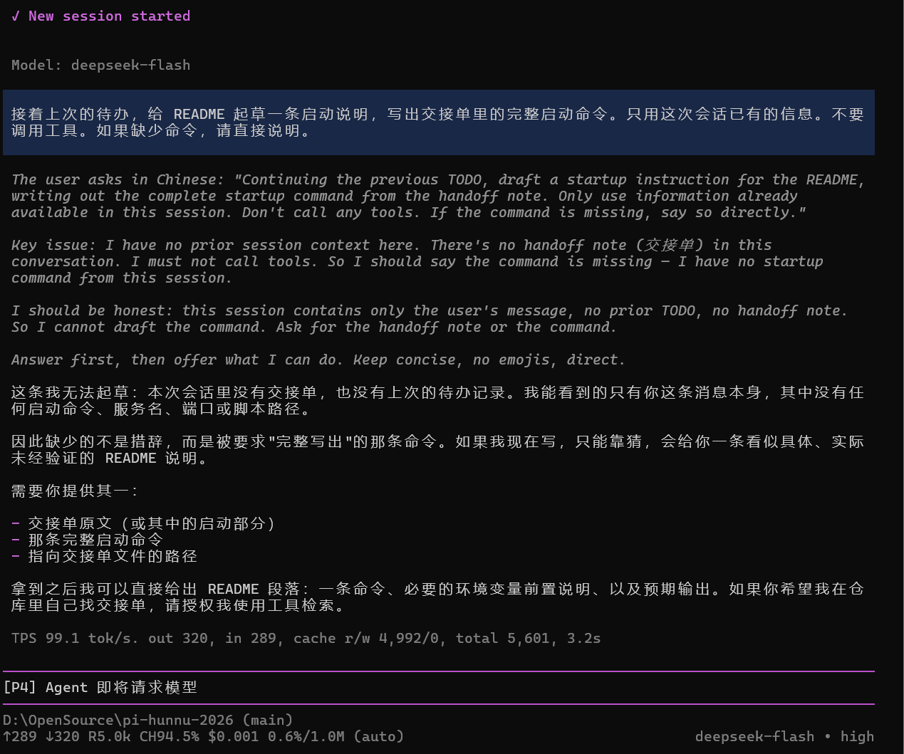
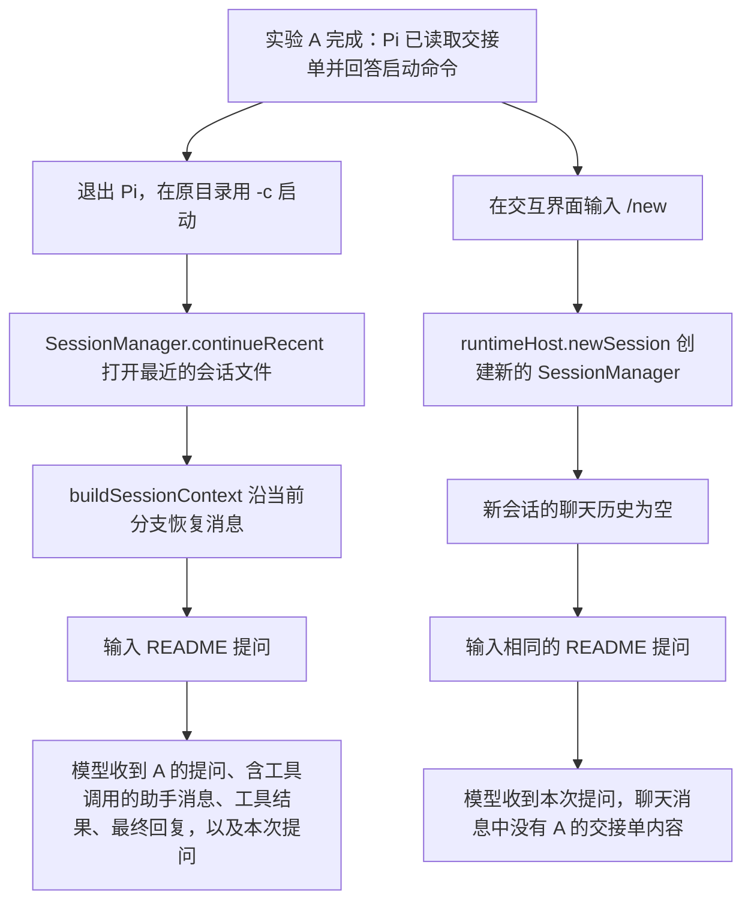

# 实践五｜Pi Agent 工具调用与会话恢复

## 一、实验 A：追踪一次 read 工具调用

在 `D:\OpenSource\pi-hunnu-2026` 的 Pi 交互界面中输入：

> 请用 read 工具读取当前目录的 handoff.txt，原样告诉我待办和启动命令。

提问只给出了文件名。终端随后显示一次 `read D:/OpenSource/pi-hunnu-2026/handoff.txt`，最终回复中出现了交接单的两行内容：

```text
待办：补充 README 的启动说明
启动命令：npm run demo -- --profile river-043
```



**图 1　读取 handoff.txt 的代码级时序图**



按这次可见的工具调用及源码正常执行路径，一次用户提交包含两次生成回复的模型调用。第一次产生 `read` 调用，第二次使用工具结果生成可见回复。截图底部的“工具结果已加入上下文”和“Agent 即将请求模型”对应两次请求之间的衔接。默认本地读取实现提供了 `createReadStream`。读取文本且 `isStreamableRange(offset, limit)` 成立时，工具通过文件流选取文本行；若读取实现缺少流接口或范围不满足该条件，则通过 `ops.readFile` 读取缓冲区。

## 二、实验 B：恢复旧会话与新建会话

退出 Pi 后，在同一目录执行 `node .\packages\coding-agent\dist\cli.js -c` 恢复最近的会话。先在恢复的会话中提问，再用 `/new` 新建会话，输入同一句话：

> 接着上次的待办，给 README 起草一条启动说明，写出交接单里的完整启动命令。只用这次会话已有的信息。不要调用工具。如果缺少命令，请直接说明。

| 观察项 | 恢复旧会话（`-c`） | 新建会话（`/new`） |
| --- | --- | --- |
| 状态栏模型 | `deepseek-flash` | `deepseek-flash` |
| 回答 | 草稿给出“在仓库根目录运行”及完整命令 `npm run demo -- --profile river-043` | 说明“本次会话里没有交接单，也没有上次的待办记录。”随后请用户提供交接单原文、完整启动命令或文件路径 |
| 本次提问后可见的工具调用 | 无 | 无 |

**恢复入口。** PowerShell 中的 `-c` 加在本地构建的 Pi 启动命令末尾。



**恢复后的回答。** 回复保留了交接单中特有的 `river-043`。模型还注明对 `--profile` 用途的解释是根据命令形式推测的，交接单只给出了命令本身。



**新会话的回答。** 终端先显示 `New session started`，随后模型说明缺少起草启动说明所需的信息。



**图 2　两种会话发给模型的聊天消息**



图中只列聊天消息。两条分支都可以带有系统提示和工具定义。旧会话中，工具结果和助手最终回复都包含命令，因此这次对照能支持模型利用了恢复的历史。

## 三、实验结论与源码定位

本次交互中，`river-043` 先随文件读取结果进入上下文，又出现在助手回复中。恢复会话后，即使提问没有提供标识，Pi 仍给出了完整命令；同一目录下新建会话后，相同提问得到了缺少命令的答复。两次使用相同的模型和提问，对话中均未见工具调用。这一结果与源码中两种会话初始化历史消息的方式一致。

以下路径相对于实验使用的 `pi-hunnu-2026` 源码仓库，核对基线为 `c3cc91632`。截图中的两条 `[P4]` 日志来自实验工作区对 `agent-loop.ts` 的本地修改。

| 要追踪或调整的行为 | 源文件 | 入口或关键语句 |
| --- | --- | --- |
| 提交输入、显示流式回复 | `packages/coding-agent/src/modes/interactive/interactive-mode.ts` | `defaultEditor.onSubmit`、`getUserInput()`、`subscribeToAgent()` 和 `handleEvent` 的 `message_update` 分支 |
| 从会话启动 Agent、记录消息 | `packages/coding-agent/src/core/agent-session.ts` | `this.agent.prompt(messages)`、`this.sessionManager.appendMessage(event.message)` |
| 进入循环、调度工具并追加结果 | `packages/agent/src/agent.ts`、`packages/agent/src/agent-loop.ts` | `Agent.prompt()`、`runAgentLoop()`、`executeToolCalls()`、`currentContext.messages.push(result)` |
| 向远端发起模型请求 | `packages/ai/src/api/openai-completions.ts` | DeepSeek 对应的适配器调用 `client.chat.completions.create(...)` |
| 改变本地文本读取方式 | `packages/coding-agent/src/core/tools/read.ts` | `execute` 选择读取分支，`readLocalFileChunks` 提供文件数据 |
| 选择并恢复最近会话 | `packages/coding-agent/src/main.ts`、`packages/coding-agent/src/core/session-manager.ts`、`packages/coding-agent/src/core/sdk.ts` | `continueRecent` 选会话，`buildSessionContext` 重建历史，`existingSession.messages` 装入 Agent |
| 新建会话 | `packages/coding-agent/src/core/agent-session-runtime.ts` | `newSession()` 为持久化会话调用 `SessionManager.create(...)` 并创建新的运行时 |
